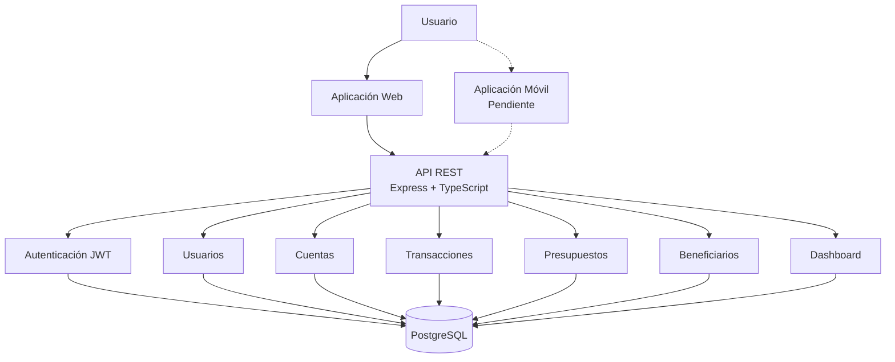

# Treo Wallet

**Billetera digital — Prueba técnica**

Treo Wallet es un proyecto de billetera digital desarrollado como parte de una prueba técnica. Permite a los usuarios consultar sus cuentas y saldos, administrar beneficiarios y registrar ingresos y gastos.

El proyecto utiliza una API REST conectada a PostgreSQL y una aplicación web desarrollada con React.

> **Estado:** En desarrollo  
> **Versión:** 0.5  
> **Última actualización:** 15 de noviembre de 2026

---

## 1. Objetivo

Desarrollar una solución financiera demostrativa que permita implementar y demostrar:

- Autenticación y autorización de usuarios.
- Administración de cuentas y beneficiarios.
- Consulta de saldos y movimientos.
- Registro de ingresos y gastos.
- Administración de presupuestos.
- Transferencias internas entre cuentas.
- Integridad de datos y seguridad.
- Aplicaciones web y móvil que consuman una misma API.

**Importante:** Treo Wallet es una prueba técnica. No realiza transferencias bancarias reales, no tiene conexión con SPEI y no mueve dinero entre instituciones financieras externas.

## 2. Tecnologías

| Componente | Tecnología |
|---|---|
| Backend | Node.js, Express y TypeScript |
| Base de datos | PostgreSQL |
| ORM | TypeORM |
| Autenticación | JWT |
| Hash de contraseñas | bcryptjs |
| Aplicación web | React, TypeScript y Vite |
| Comunicación HTTP | Fetch API |
| Control de versiones | Git y GitHub |
| Aplicación móvil | Pendiente de implementación |
| Despliegue | Pendiente |

## 3. Arquitectura

La solución mantiene una separación entre frontend, backend y base de datos.

- **Web:** interfaz para administrar cuentas, beneficiarios, presupuestos y movimientos.
- **API:** gestiona autenticación, validaciones y operaciones de negocio.
- **PostgreSQL:** almacena usuarios, cuentas, categorías, movimientos, presupuestos y beneficiarios.
- **Mobile:** aplicación prevista para consumir la misma API; todavía no implementada.



La API es responsable de validar las operaciones y controlar el acceso a los datos. Las aplicaciones cliente no acceden directamente a PostgreSQL.

## 4. Estructura del proyecto

```text
treowallet/
│
├── api/                            # Backend y API REST
│   ├── src/
│   │   ├── config/                 # Configuración de TypeORM
│   │   ├── controllers/            # Lógica de los endpoints
│   │   ├── entities/               # Entidades de PostgreSQL
│   │   ├── middleware/             # Autenticación JWT
│   │   ├── migrations/             # Migraciones
│   │   ├── routes/                 # Rutas de la API
│   │   ├── scripts/                # Scripts auxiliares
│   │   ├── types/                  # Tipos personalizados
│   │   ├── app.ts
│   │   └── server.ts
│   └── package.json
│
├── web/                            # Aplicación web React
│   ├── src/
│   │   ├── pages/
│   │   │   ├── Login.tsx
│   │   │   ├── Dashboard.tsx
│   │   │   ├── Accounts.tsx
│   │   │   ├── Budgets.tsx
│   │   │   ├── Beneficiaries.tsx
│   │   │   └── Transactions.tsx
│   │   ├── services/
│   │   │   └── api.ts
│   │   ├── App.tsx
│   │   ├── App.css
│   │   ├── index.css
│   │   └── main.tsx
│   └── package.json
│
├── mobile/                         # Aplicación móvil (pendiente)
│
├── specs/                          # Especificaciones del proyecto
│   ├── requirements.md
│   ├── design.md
│   ├── tasks.md
│   └── ai-log.md
│
├── docs/                           # Documentación técnica
│
└── README.md
```

La estructura representa los módulos principales. Se podrá ampliar conforme avance el desarrollo.

## 5. Funcionalidades

### Implementadas y verificadas

**Autenticación**
- Inicio de sesión.
- Validación de credenciales.
- Contraseñas protegidas mediante hash.
- Autenticación mediante JWT.
- Protección de rutas privadas.

**Dashboard**
- Consulta de información del usuario.
- Consulta de saldo inicial, ingresos, gastos y saldo actual.
- Visualización de los últimos movimientos.

**Cuentas**
- Consulta de cuentas del usuario.
- Consulta de saldos y movimientos por cuenta.

**Presupuestos**
- Consulta de presupuestos.
- Registro y actualización.
- Eliminación.
- Cálculo de gastos y saldo disponible.

**Beneficiarios**
- Registro y consulta.
- Validación de CLABE de 18 dígitos.
- Validación matemática del dígito de control.
- Eliminación de beneficiarios.

**Transacciones**
- Registro de ingresos y gastos.
- Categorías dinámicas según el tipo de movimiento.
- Consulta del historial.
- Filtros por tipo de movimiento.
- Eliminación de movimientos.

### Pendientes

- Registro de usuarios desde la interfaz.
- Transferencias internas entre cuentas.
- Validación de saldo y control de concurrencia para transferencias.
- Idempotencia de operaciones financieras.
- Comprobantes de transferencias.
- Aplicación móvil.
- Pruebas automatizadas.
- Despliegue.

## 6. Estado del desarrollo

| Componente | Estado |
|---|---|
| Repositorio GitHub | Completado |
| Backend Express | Completado |
| Conexión PostgreSQL mediante TypeORM | Completada |
| Entidades principales | Implementadas |
| Autenticación JWT | Implementada y verificada |
| Dashboard web | Implementado y verificado |
| Cuentas | Implementadas y verificadas |
| Presupuestos | Implementados y verificados |
| Beneficiarios | Implementados y verificados |
| Transacciones | Implementadas y verificadas |
| Integración web, API y PostgreSQL | Verificada |
| Aplicación móvil | Pendiente |
| Transferencias internas | Pendiente |
| Pruebas automatizadas | Pendiente |
| Despliegue | Pendiente |

Para consultar el seguimiento detallado, revisar `specs/tasks.md`.

## 7. Requisitos previos

- Node.js.
- npm.
- PostgreSQL.
- Git.
- Visual Studio Code o un editor compatible.

## 8. Instalación y ejecución

### 8.1 Clonar el repositorio

```bash
git clone https://github.com/Yair-Blad/treowallet
cd treowallet
```

### 8.2 Configurar el backend

Entrar en la carpeta `api/`:

```bash
cd api
npm install
```

Configurar las variables de entorno necesarias para PostgreSQL, JWT y la conexión con el frontend.

Iniciar el servidor:

```bash
npm run dev
```

La API estará disponible localmente en:

```text
http://localhost:3000
```

### 8.3 Configurar el frontend

Desde la carpeta `web/`:

```bash
cd web
npm install
```

Configurar `VITE_API_URL` con la dirección de la API, por ejemplo:

```text
http://localhost:3000/api
```

Iniciar Vite:

```bash
npm run dev
```

La dirección local de la aplicación se mostrará en la terminal.

### 8.4 Base de datos

La aplicación utiliza PostgreSQL y TypeORM.

La sincronización automática del esquema está deshabilitada (`synchronize: false`). Los cambios estructurales deben gestionarse mediante migraciones.

No subir archivos `.env` ni credenciales al repositorio.

## 9. Seguridad y decisiones técnicas

- Las contraseñas se almacenan mediante hash con bcryptjs.
- La autenticación utiliza JWT.
- Las rutas protegidas verifican el token y el usuario autenticado.
- Las consultas de datos consideran la identidad del usuario.
- Se utiliza TypeORM para el acceso a PostgreSQL.
- La sincronización automática del esquema permanece deshabilitada.
- Los identificadores `BIGINT` y los importes `NUMERIC` se manejan como cadenas en las entidades cuando corresponde, para preservar su precisión.

Las transferencias todavía requieren implementar controles adicionales de integridad financiera, concurrencia e idempotencia antes de considerarse funcionalidad disponible.

## 10. Pruebas y calidad

Hasta el momento se han realizado verificaciones manuales de:

- Inicio de sesión con credenciales correctas e incorrectas.
- Separación de información entre usuarios.
- Consulta de saldos y movimientos.
- Registro y eliminación de beneficiarios.
- Validación de CLABE.
- Registro de ingresos y gastos.
- Cambio dinámico de categorías.
- Filtros y eliminación de transacciones.
- Integración entre frontend, backend y PostgreSQL.
- Compilación de backend y frontend.

Las pruebas automatizadas y de concurrencia siguen pendientes.

## 11. Documentación

| Archivo | Descripción |
|---|---|
| `specs/requirements.md` | Requisitos funcionales y técnicos |
| `specs/design.md` | Diseño y arquitectura |
| `specs/tasks.md` | Plan de trabajo y seguimiento |
| `specs/ai-log.md` | Registro breve de asistencia y decisiones de IA |
| `docs/` | Documentación técnica complementaria |

## 12. Alcance y limitaciones

Treo Wallet es una demostración técnica.

No incluye actualmente:

- Conexión con SPEI.
- Transferencias bancarias externas.
- Integración con instituciones financieras.
- Movimiento de dinero real.
- Despliegue productivo.
- Validación externa de titularidad de CLABE.

## 13. Control de versiones

Se utiliza Git para registrar los cambios y relacionar las implementaciones con las tareas correspondientes.

Ejemplos de convenciones de commits:

```text
docs: update project documentation
feat(api): implement transaction endpoints
feat(web): integrate transactions module
fix(web): correct dashboard navigation
test: validate transaction operations
```

## 14. Autoría

**Proyecto:** Treo Wallet  
**Tipo:** Prueba técnica  
**Moneda:** Peso mexicano (MXN)  
**Repositorio:** [GitHub](https://github.com/Yair-Blad/treowallet)

---

*Este documento se actualizará conforme avance el desarrollo del proyecto.*