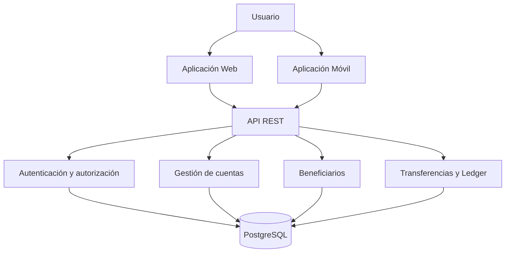

# Treo Wallet

**Billetera digital — Prueba técnica**

Treo Wallet es un proyecto de billetera digital desarrollado como parte de una prueba técnica. Su objetivo es permitir a los usuarios consultar sus cuentas y saldos, administrar beneficiarios y realizar transferencias internas entre cuentas de la misma plataforma.

El proyecto contempla una arquitectura compartida entre una aplicación web y una aplicación móvil, respaldadas por una API REST y una base de datos PostgreSQL.

> **Estado del proyecto:** En desarrollo  
> **Versión:** 0.2  
> **Última actualización:** 11 de noviembre de 2026

---

## 1. Objetivo del proyecto

Desarrollar una solución financiera demostrativa que permita implementar y demostrar:

- Autenticación y autorización de usuarios.
- Administración de cuentas y beneficiarios.
- Consulta de saldos y movimientos.
- Transferencias internas entre cuentas.
- Integridad contable y consistencia de saldos.
- Control de concurrencia e idempotencia.
- Aplicación web y móvil que consuman la misma API.
- Pruebas automatizadas y documentación técnica.

**Importante:** Treo Wallet es una prueba técnica. No realiza transferencias bancarias reales, no tiene conexión con SPEI y no mueve dinero entre instituciones financieras externas.

## 2. Tecnologías

| Componente | Tecnología |
|---|---|
| Backend | Node.js, Express y TypeScript |
| Base de datos | PostgreSQL |
| ORM | TypeORM |
| Validación | Zod |
| API | REST / OpenAPI |
| Aplicación web | React, TypeScript y Vite |
| Estado remoto web | TanStack Query |
| Aplicación móvil | React Native y Expo |
| Control de versiones | Git y GitHub |
| Despliegue propuesto | AWS |

Las tecnologías indicadas representan la arquitectura objetivo. Algunas todavía están pendientes de configuración e integración.

## 3. Arquitectura general

La solución utiliza una arquitectura de monorepo con tres aplicaciones principales:

- **Web:** interfaz para consultar cuentas, administrar beneficiarios y realizar transferencias.
- **Mobile:** aplicación móvil para consultar saldos, movimientos y realizar transferencias.
- **API:** servicio central encargado de la autenticación, validación de operaciones y comunicación con PostgreSQL.



La API será el punto central de validación de las operaciones financieras. Las aplicaciones cliente no modificarán directamente los saldos ni ejecutarán operaciones contables.

## 4. Estructura del proyecto

```text
treowallet/
│
├── api/                  # Backend y API REST
│
├── web/                  # Aplicación web con React
│   └── src/
│       ├── pages/
│       │   ├── Login.tsx
│       │   └── Dashboard.tsx
│       ├── styles/
│       │   └── Dashboard.css
│       ├── App.tsx
│       ├── App.css
│       ├── index.css
│       └── main.tsx
│
├── mobile/               # Aplicación móvil con Expo
│
├── packages/
│   └── shared/           # Tipos y utilidades compartidas
│
├── specs/                # Especificaciones y planificación
│   ├── requirements.md
│   ├── design.md
│   ├── tasks.md
│   └── ai-log.md
│
├── docs/                 # Documentación técnica
│
└── README.md              # Documentación general
```

La estructura se irá completando conforme se implementen los módulos del proyecto.

## 5. Funcionalidades principales

### Autenticación

- Registro e inicio de sesión.
- Contraseñas protegidas mediante hash.
- JWT de corta duración.
- Refresh tokens rotatorios.
- Protección de recursos por usuario.

### Cuentas

- Consulta de cuentas asociadas al usuario.
- Consulta de saldos en pesos mexicanos (MXN).
- Prevención de saldos negativos.
- Consistencia entre saldos y movimientos contables.

### Beneficiarios

- Registro y administración de beneficiarios.
- Validación de CLABE de 18 dígitos.
- Validación matemática del dígito de control.

### Transferencias

- Transferencias internas entre cuentas de la plataforma.
- Confirmación previa a la operación.
- Límite diario configurable.
- OTP simulado para operaciones que superen un umbral.
- Claves de idempotencia para prevenir duplicados.
- Comprobante de operación.

### Historial

- Consulta de movimientos.
- Filtros por fecha y tipo.
- Paginación mediante cursor.
- Visualización de estados y referencias.

## 6. Estado actual del desarrollo

| Componente | Estado |
|---|---|
| Repositorio GitHub | Inicializado |
| Estructura del monorepo | Creada inicialmente |
| Node.js | Instalado |
| PostgreSQL | Instalado |
| Aplicación web | Inicializada |
| Login web | Primera interfaz visual |
| Dashboard web | Primera interfaz visual |
| API REST | Pendiente |
| Conexión con PostgreSQL | Pendiente |
| Autenticación real | Pendiente |
| Cuentas y saldos | Pendiente |
| Beneficiarios | Pendiente |
| Transferencias | Pendiente |
| Historial de movimientos | Pendiente |
| Aplicación móvil | Pendiente |
| Pruebas automatizadas | Pendiente |
| Integración completa | Pendiente |

**Nota:** El Login y el Dashboard actuales son interfaces demostrativas. Todavía no existe autenticación real ni conexión con datos financieros del backend.

Para consultar el avance detallado, revisar `specs/tasks.md`.

## 7. Requisitos previos

Para trabajar con el proyecto se necesitarán:

- Node.js 20 o superior.
- npm.
- PostgreSQL 15 o superior.
- Git.
- Visual Studio Code o editor compatible.
- Expo Go o un simulador para el desarrollo móvil, cuando se implemente esa aplicación.

## 8. Instalación y configuración

### 8.1 Clonar el repositorio

```bash
git clone https://github.com/Yair-Blad/treowallet
cd treowallet
```

### 8.2 Instalar dependencias

La instalación definitiva dependerá de la configuración de npm workspaces y de los `package.json` de cada aplicación.

Cuando esté configurado el monorepo, se documentará aquí el comando de instalación correspondiente.

### 8.3 Configurar PostgreSQL

Se utilizará una base de datos local para el desarrollo.

La configuración de conexión se realizará mediante variables de entorno. Los nombres definitivos se documentarán cuando se implemente la configuración del backend.

No subir archivos `.env` con credenciales al repositorio.

### 8.4 Ejecutar la aplicación web

Actualmente, la aplicación web utiliza Vite.

Desde la carpeta `web/`, una vez instaladas sus dependencias:

```bash
npm install
npm run dev
```

Vite mostrará en la terminal la dirección local para abrir la aplicación en el navegador.

**Nota:** Los scripts definitivos pueden cambiar al configurar npm workspaces en la raíz.

## 9. Seguridad e integridad financiera

La integridad financiera es una prioridad del proyecto.

Se consideran los siguientes criterios técnicos:

- Las transferencias se ejecutarán dentro de transacciones de PostgreSQL.
- Se utilizarán bloqueos de cuentas para controlar operaciones concurrentes.
- Se implementará idempotencia para evitar operaciones duplicadas.
- Los importes monetarios se manejarán mediante centavos enteros o `NUMERIC`.
- No se utilizará `Number` de JavaScript para realizar cálculos monetarios.
- Los movimientos contables deberán mantener débitos y créditos equilibrados.
- Se implementarán restricciones para impedir saldos negativos.
- Se mantendrá una bitácora de auditoría append-only.
- Los logs no deberán exponer contraseñas, tokens ni credenciales.

## 10. Pruebas y calidad

El proyecto contempla:

- Pruebas unitarias de lógica de negocio.
- Pruebas de integración con PostgreSQL real.
- Pruebas de autenticación y autorización.
- Pruebas de validación de CLABE.
- Pruebas de idempotencia.
- Pruebas de transferencias con fondos insuficientes.
- Pruebas de concurrencia con 100 transferencias simultáneas.
- Análisis de consultas con `EXPLAIN ANALYZE` sobre al menos 100,000 movimientos.
- CI para ejecutar lint y pruebas automatizadas.

## 11. Documentación

Los documentos del proyecto se encuentran organizados de la siguiente manera:

| Archivo | Descripción |
|---|---|
| `specs/requirements.md` | Requisitos funcionales y técnicos |
| `specs/design.md` | Diseño y arquitectura técnica |
| `specs/tasks.md` | Plan de trabajo y seguimiento |
| `specs/ai-log.md` | Registro de herramientas y decisiones asistidas por IA |
| `docs/aws-deploy.md` | Propuesta de arquitectura y despliegue en AWS |

## 12. Alcance y limitaciones

Esta versión del proyecto está orientada a una demostración técnica.

No incluye:

- Conexión real con SPEI.
- Transferencias a cuentas bancarias externas.
- Integración con instituciones financieras.
- Movimiento de dinero real.
- Despliegue productivo en AWS.
- Validación externa de titularidad de CLABE.

## 13. Control de versiones

El proyecto utiliza Git para registrar los cambios y relacionar las implementaciones con las tareas correspondientes.

Se busca mantener commits descriptivos y organizados por funcionalidad.

Ejemplos:

```text
docs: update project specifications
chore: configure npm workspaces
feat(api): initialize express server
feat(auth): implement user authentication
feat(web): implement dashboard interface
feat(transfers): implement internal transfers
test(transfers): add concurrency tests
```

## 14. Autoría

**Proyecto:** Treo Wallet  
**Tipo:** Prueba técnica  
**Moneda:** Peso mexicano (MXN)  
**Repositorio:** GitHub

---

*Este README se actualizará conforme avance el desarrollo y se incorporen nuevas funcionalidades.*