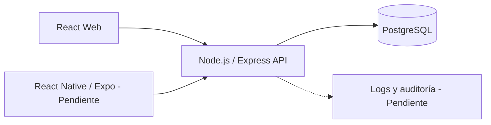

# Treo Wallet — Diseño técnico

**Estado:** En desarrollo  
**Versión:** 0.5  
**Fecha de actualización:** 15 de noviembre de 2026

## 1. Objetivo del diseño

Definir una arquitectura que permita construir una billetera digital de alcance acotado, priorizando integridad financiera, seguridad, trazabilidad y facilidad de evaluación.

Este documento mantiene la arquitectura objetivo del proyecto y registra el avance actual de implementación para distinguir las funcionalidades desarrolladas de las que siguen pendientes.

## 2. Arquitectura propuesta

Se utiliza un **monolito modular** con una API central. No se justifican microservicios para el alcance de esta prueba.

La arquitectura contempla una aplicación web y una futura aplicación móvil que consumirán la misma API, con PostgreSQL como base de datos central.



### 2.1 Estructura del repositorio

El proyecto utiliza una estructura organizada por aplicaciones y documentación:

```text
treowallet/
├── api/
│   └── src/
├── web/
│   └── src/
├── mobile/             # Pendiente
├── specs/
├── docs/
└── README.md
```

La estructura permite mantener separados el backend, el frontend, la futura aplicación móvil, las especificaciones y la documentación.

La carpeta `packages/shared` podrá incorporarse posteriormente si se requiere compartir tipos, esquemas de validación o utilidades entre aplicaciones.

### 2.2 Estado actual de implementación

| Componente | Estado | Descripción |
|---|---|---|
| Repositorio | Completado | Estructura creada y publicada en GitHub. |
| Entorno local | Completado | Node.js y PostgreSQL instalados. |
| Backend | Implementado | API Express con TypeScript y conexión PostgreSQL mediante TypeORM. |
| Autenticación | Implementada | Login con bcrypt y JWT. |
| Dashboard API | Implementado | Consulta de resumen financiero y últimos movimientos. |
| Frontend web | Implementado | React, TypeScript y Vite. |
| Login web | Implementado | Conectado con el endpoint de autenticación. |
| Dashboard web | Implementado | Consume información real de la API. |
| Base de datos | Implementada | PostgreSQL conectado al backend. |
| Cuentas y presupuestos | Implementados | Consulta y administración desde la aplicación web. |
| Beneficiarios | Implementados | Registro, consulta y eliminación con validación de CLABE. |
| Movimientos | Implementados | Registro de ingresos y gastos, filtros por tipo y eliminación. |
| Aplicación móvil | Pendiente | Falta inicializar e implementar las pantallas. |
| Transferencias y ledger | Pendiente | Diseño definido; implementación pendiente. |
| Pruebas automatizadas | Pendiente | Se han realizado pruebas manuales de los módulos implementados. |

## 3. Backend

### 3.1 Tecnologías

**Implementadas:**

- Node.js.
- Express.
- TypeScript en modo estricto.
- TypeORM.
- PostgreSQL.
- JWT para autenticación.
- bcrypt para hash de contraseñas.

**Pendientes o previstas:**

- Zod para validación de datos.
- Refresh tokens rotatorios.
- Documentación OpenAPI.
- Logs estructurados.
- Manejo centralizado de errores con RFC 7807.

### 3.2 Organización actual

La API utiliza una organización por controladores, entidades, rutas, configuración, middleware y scripts.

```text
api/
└── src/
    ├── config/
    │   └── database.ts
    ├── controllers/
    │   ├── auth.controller.ts
    │   ├── users.controller.ts
    │   ├── dashboard.controller.ts
    │   ├── accounts.controller.ts
    │   ├── budgets.controller.ts
    │   ├── categories.controller.ts
    │   ├── beneficiaries.controller.ts
    │   └── transactions.controller.ts
    ├── entities/
    │   ├── User.ts
    │   ├── Account.ts
    │   ├── Category.ts
    │   ├── Transaction.ts
    │   ├── Budget.ts
    │   └── Beneficiary.ts
    ├── middleware/
    │   └── auth.middleware.ts
    ├── migrations/
    ├── routes/
    ├── scripts/
    ├── types/
    ├── app.ts
    └── server.ts
```

La conexión a PostgreSQL se administra mediante TypeORM y `synchronize: false`. El servidor inicializa la conexión antes de comenzar a escuchar peticiones.

La lógica de negocio se encuentra actualmente en los controladores. Conforme se incorporen operaciones financieras más complejas, la lógica de transferencias y ledger deberá separarse en servicios para evitar concentrarla en los controladores de Express.

## 4. Modelo de datos inicial

Las tablas implementadas actualmente son:

| Entidad | Responsabilidad | Estado |
|---|---|---|
| `users` | Identidad, credenciales y estado del usuario. | Implementada |
| `accounts` | Cuentas y saldo inicial. | Implementada |
| `categories` | Categorías de ingresos y gastos. | Implementada |
| `transactions` | Registro de ingresos y gastos. | Implementada |
| `budgets` | Presupuestos por categoría y periodo. | Implementada |
| `beneficiaries` | Beneficiarios registrados y CLABE. | Implementada |

Entidades propuestas para las transferencias y controles financieros:

| Entidad | Responsabilidad |
|---|---|
| `transfers` | Operación de transferencia, estado, concepto y referencia. |
| `ledger_entries` | Asientos de débito y crédito. |
| `audit_logs` | Eventos relevantes de auditoría. |
| `refresh_tokens` | Sesiones renovables y rotación de tokens. |
| `idempotency_keys` | Resultado y huella de solicitudes idempotentes. |
| `otp_challenges` | Retos OTP, expiración y consumo. |

Las relaciones, índices, restricciones y columnas definitivas de las entidades futuras se detallarán antes de crear sus migraciones.

El modelo deberá garantizar integridad referencial y consistencia de las operaciones financieras desde la base de datos.

## 5. Modelo monetario y ledger

- No utilizar `number` de JavaScript para operaciones monetarias que requieran precisión decimal.
- Representar importes como centavos enteros o como `NUMERIC` en PostgreSQL, definiendo una conversión segura en la API.
- Cada transferencia interna deberá producir al menos dos asientos: débito en la cuenta origen y crédito en la cuenta destino.
- La suma de los asientos de una transferencia deberá ser cero.
- El saldo de la cuenta podrá mantenerse como valor actualizado para consulta eficiente, pero deberá actualizarse en la misma transacción que los asientos.
- Incluir una estrategia de conciliación para detectar diferencias entre saldos y ledger.
- Aplicar restricciones de base de datos para impedir saldos negativos.
- Evitar que los cálculos monetarios dependan de operaciones de punto flotante.

**Estado actual:** Las cuentas tienen un saldo inicial y los movimientos de ingresos y gastos se utilizan para calcular el saldo actual. El ledger contable de doble partida y las transferencias todavía no están implementados.

## 6. Flujo transaccional de transferencia

Flujo propuesto:

1. Autenticar al usuario y validar que puede operar sobre la cuenta origen.
2. Validar el payload mediante Zod.
3. Verificar la clave de idempotencia y la huella de la solicitud.
4. Iniciar una transacción PostgreSQL.
5. Bloquear las cuentas afectadas mediante `SELECT ... FOR UPDATE` en orden determinista de identificador.
6. Verificar saldo, límites diarios, beneficiario/destino y requisitos OTP.
7. Crear la transferencia y sus asientos contables.
8. Actualizar los saldos dentro de la misma transacción.
9. Registrar el evento de auditoría.
10. Guardar el resultado asociado a la clave de idempotencia y confirmar la transacción.
11. Devolver el comprobante y resultado.

Ante cualquier error, revertir la transacción. Una repetición con la misma clave y el mismo contenido deberá devolver el resultado original sin volver a debitar. La misma clave con contenido diferente deberá rechazarse.

La alternativa `SERIALIZABLE` puede evaluarse, pero requiere reintentos acotados ante errores de serialización. La decisión final deberá documentarse y probarse.

**Estado actual:** Pendiente de implementación.

## 7. Límites diarios y OTP

- El límite diario será configurable.
- La ventana diaria deberá calcularse usando la zona horaria de negocio acordada, inicialmente `America/Mexico_City`.
- La comprobación del límite deberá ser segura ante transferencias concurrentes.
- El OTP será simulado para la prueba técnica.
- El OTP deberá tener expiración, límite de intentos y consumo único.
- El umbral que activa OTP y el límite diario quedan pendientes de definir.

**Estado actual:** Pendiente de implementación.

## 8. API y errores

La API utiliza rutas REST bajo el prefijo `/api`.

**Implementado actualmente:**

- Middleware de autenticación JWT.
- Controladores y rutas para autenticación, usuarios, dashboard, cuentas, presupuestos, categorías, beneficiarios y movimientos.
- Validaciones de datos en los controladores.
- Respuestas HTTP para operaciones exitosas y errores de validación.
- Restricción de acceso a los recursos según el usuario autenticado.

**Pendiente:**

- Versionado de API, por ejemplo `/api/v1`.
- Validación centralizada mediante Zod.
- Documentación OpenAPI 3.1.
- Errores con formato RFC 7807 (Problem Details).
- Middleware de rate limiting.
- Logs estructurados y manejo centralizado de errores.
- Definir contratos definitivos y respuestas consistentes.

Rutas implementadas:

- `/api/auth`
- `/api/users`
- `/api/dashboard`
- `/api/accounts`
- `/api/budgets`
- `/api/categories`
- `/api/beneficiaries`
- `/api/transactions`

Rutas futuras:

- `/api/transfers`
- Endpoints de refresh y logout con invalidación de refresh tokens.

## 9. Web y móvil

### 9.1 Aplicación web

La aplicación web consume la API mediante `fetch`, utilizando un servicio centralizado en `web/src/services/api.ts`.

Los endpoints integrados incluyen:

| Método | Endpoint | Descripción |
|---|---|---|
| POST | `/api/auth/login` | Autenticación del usuario. |
| GET | `/api/users/me` | Consulta del perfil del usuario autenticado. |
| GET | `/api/dashboard` | Consulta del resumen financiero y movimientos. |
| GET | `/api/accounts` | Consulta de cuentas y saldos. |
| GET/POST/PUT/DELETE | `/api/budgets` | Consulta y administración de presupuestos. |
| GET/POST/DELETE | `/api/beneficiaries` | Consulta, registro y eliminación de beneficiarios. |
| GET/POST/DELETE | `/api/transactions` | Consulta, registro y eliminación de movimientos. |
| GET | `/api/categories` | Consulta de categorías por tipo. |

Las peticiones protegidas utilizan el encabezado:

`Authorization: Bearer <token>`

El frontend administra la sesión mediante almacenamiento local o de sesión del navegador, según la opción seleccionada por el usuario.

La API es responsable de validar el JWT y restringir la información consultada al usuario autenticado.

La integración fue comprobada mediante pruebas manuales de inicio de sesión, consulta de información financiera, administración de cuentas, presupuestos, beneficiarios y movimientos.

Tecnologías implementadas:

- React.
- TypeScript.
- Vite.
- CSS.
- Fetch API.
- Servicio centralizado para las peticiones al backend.
- Formato monetario `es-MX`.

Tecnologías previstas:

- TanStack Query para estado remoto.
- Formularios con validación centralizada.
- Clave de idempotencia generada una vez por intento de transferencia y reutilizada ante reintentos del mismo intento.

#### Estructura actual de la aplicación web

```text
web/
└── src/
    ├── pages/
    │   ├── Login.tsx
    │   ├── Dashboard.tsx
    │   ├── Accounts.tsx
    │   ├── Budgets.tsx
    │   ├── Beneficiaries.tsx
    │   └── Transactions.tsx
    ├── services/
    │   └── api.ts
    ├── App.tsx
    ├── App.css
    ├── index.css
    └── main.tsx
```

#### Login

Se implementó una interfaz de inicio de sesión conectada con el backend que contempla:

- Campo de correo electrónico.
- Campo de contraseña.
- Opción para mostrar u ocultar la contraseña.
- Opción para recordar la sesión.
- Validación de credenciales mediante la API.
- Acceso al Dashboard después de iniciar sesión.
- Manejo de credenciales incorrectas.
- Cierre de sesión.

**Estado:** Implementado y conectado con la API. La autenticación se realiza mediante JWT.

#### Dashboard

La aplicación cuenta con un panel principal que incluye:

- Menú lateral de navegación.
- Identidad visual de Treo Wallet.
- Información del usuario autenticado.
- Resumen de saldo.
- Indicadores de ingresos y gastos.
- Lista de los últimos cinco movimientos.
- Acciones rápidas y navegación entre módulos.

**Estado:** Implementado y conectado con datos reales de PostgreSQL mediante la API.

#### Cuentas

Se implementó la consulta de cuentas asociadas al usuario y la visualización de sus saldos.

**Estado:** Implementado y probado manualmente.

#### Presupuestos

Se implementó la consulta, registro, actualización y eliminación de presupuestos.

**Estado:** Implementado y probado manualmente.

#### Beneficiarios

Se implementó el registro, consulta y eliminación de beneficiarios, incluyendo validación de CLABE de 18 dígitos y su dígito de control.

**Estado:** Implementado y probado manualmente. La edición de beneficiarios sigue pendiente.

#### Movimientos

Se implementó el registro de ingresos y gastos, consulta de movimientos, filtrado por tipo y eliminación.

Las categorías disponibles cambian según el tipo de movimiento seleccionado.

**Estado:** Implementado y probado manualmente.

#### Pendientes de la aplicación web

- Implementar registro de usuarios.
- Implementar recuperación de contraseña.
- Completar la gestión de sesiones y refresh tokens.
- Implementar historial con filtros por fecha y paginación.
- Incorporar edición de beneficiarios.
- Implementar el flujo de transferencias y comprobantes.
- Incorporar validación centralizada de formularios.
- Integrar TanStack Query.
- Implementar pruebas de componentes y flujos principales.

### 9.2 Aplicación móvil

Tecnologías propuestas:

- React Native con Expo.
- TypeScript.
- Tokens en almacenamiento seguro del sistema.
- Reutilizar la misma clave de idempotencia cuando se reintente una solicitud por pérdida de conectividad.
- Mostrar el estado confirmado por el servidor, sin asumir que una solicitud fallida de red significa que la transferencia no ocurrió.
- Ocultar información sensible al pasar a segundo plano.

La aplicación móvil todavía está pendiente de inicialización e implementación.

## 10. Pruebas y calidad

Se deberán implementar las siguientes pruebas:

- Unitarias para reglas de dominio y validadores.
- Validación de CLABE y su dígito verificador.
- Integración con PostgreSQL real.
- Pruebas de idempotencia, límites y saldo no negativo.
- Prueba de 100 transferencias simultáneas desde una cuenta.
- Seed de al menos 100,000 movimientos y revisión con `EXPLAIN ANALYZE`.
- Pruebas de componentes y flujo web.
- Prueba del flujo de transferencia, incluyendo saldo insuficiente.
- Lint y pruebas en CI.

**Estado actual:** Se realizaron pruebas manuales de integración para autenticación, Dashboard, cuentas, presupuestos, beneficiarios y movimientos. Las compilaciones de backend y frontend se verificaron satisfactoriamente. Las pruebas automatizadas, financieras y de concurrencia siguen pendientes.

## 11. AWS — propuesta inicial

No se realizará despliegue como parte del alcance. La propuesta a documentar considera:

- ECS Fargate para ejecutar la API.
- Amazon RDS PostgreSQL Multi-AZ, respaldos y recuperación a un punto en el tiempo.
- S3 y CloudFront para los recursos web.
- Secrets Manager para secretos.
- CloudWatch, CloudTrail y OpenTelemetry/X-Ray para observabilidad.
- GitHub Actions con OIDC para CI/CD.
- RDS Proxy o pooling de conexiones para controlar conexiones a PostgreSQL.
- Infraestructura como código mediante AWS CDK o Terraform.

Se deberán documentar RPO/RTO, retención de auditoría, estrategia de ambientes y escalamiento.

**Estado actual:** Propuesta pendiente de documentación. No existe despliegue en AWS.

## 12. Decisiones por cerrar

- Umbral OTP y límite diario.
- Tipos y estados definitivos de transferencia.
- Política de expiración y revocación de refresh tokens.
- Estrategia final para concurrencia y reintentos.
- Diseño definitivo del ledger y conciliación de saldos.
- Índices y estrategia de consulta de historial.
- Configuración de ambientes local, pruebas y CI.
- Política de almacenamiento y renovación de tokens en web.
- Estrategia de navegación y protección de rutas.
- Contratos definitivos entre frontend y backend.

## 13. Historial de versiones

| Versión | Fecha | Cambios |
|---|---|---|
| 0.1 | 10/11/2026 | Diseño inicial de arquitectura, backend, modelo de datos y estrategia financiera. |
| 0.2 | 11/11/2026 | Actualización del estado del proyecto. Se documenta la estructura web, Login y Dashboard implementados visualmente, así como las tareas de integración pendientes. |
| 0.3 | 11/11/2026 | Creación de la base de datos en PostgreSQL, integración y conexión con el backend de Treo Wallet, e implementación del hash de contraseñas para su almacenamiento seguro. |
| 0.4 | 11/11/2026 | Integración y conexión entre el backend, la base de datos PostgreSQL y el frontend de Treo Wallet. |
| 0.5 | 15/11/2026 | Actualización del diseño técnico y del avance de cuentas, presupuestos, beneficiarios y movimientos en la parte web. Registro de pruebas manuales y actualización de la arquitectura implementada. |