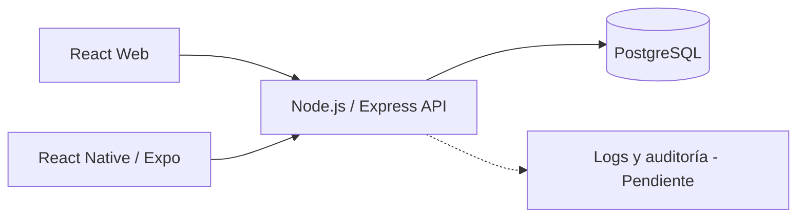

# Treo Wallet — Diseño técnico

**Estado:** En desarrollo  
**Versión:** 0.6  
**Fecha de actualización:** 16 de noviembre de 2026

## 1. Objetivo del diseño

Definir una arquitectura que permita construir una billetera digital de alcance acotado, priorizando integridad financiera, seguridad, trazabilidad y facilidad de evaluación.

Este documento mantiene la arquitectura objetivo del proyecto y registra el avance actual de implementación para distinguir las funcionalidades desarrolladas de las que siguen pendientes.

Treo Wallet es una aplicación de billetera digital simulada. Las operaciones de transferencia se realizan dentro del sistema y no representan movimientos reales mediante SPEI ni conexiones bancarias externas.

## 2. Arquitectura propuesta

Se utiliza un **monolito modular** con una API central. No se justifican microservicios para el alcance actual del proyecto.

La arquitectura contempla una aplicación web y una aplicación móvil que consumen la misma API, con PostgreSQL como base de datos central.



### 2.1 Estructura del repositorio

El proyecto utiliza una estructura organizada por aplicaciones y documentación:

```text
treowallet/
├── api/
│   └── src/
├── web/
│   └── src/
├── mobile/
│   └── src/
├── specs/
├── docs/
└── README.md
```

La estructura permite mantener separados el backend, el frontend web, la aplicación móvil, las especificaciones y la documentación.

La carpeta `packages/shared` podrá incorporarse posteriormente si se requiere compartir tipos, esquemas de validación o utilidades entre aplicaciones.

### 2.2 Estado actual de implementación

| Componente | Estado | Descripción |
|---|---|---|
| Repositorio | Completado | Estructura creada y publicada en GitHub. |
| Entorno local | Completado | Node.js y PostgreSQL instalados. |
| Backend | Implementado | API Express con TypeScript y conexión PostgreSQL mediante TypeORM. |
| Autenticación | Implementada | Login con bcrypt y JWT. |
| Dashboard API | Implementado | Consulta de resumen financiero y últimos movimientos. |
| Frontend web | Implementado | React, TypeScript y Vite. |
| Login web | Implementado | Conectado con el endpoint de autenticación. |
| Dashboard web | Implementado | Consume información real de la API. |
| Base de datos | Implementada | PostgreSQL conectado al backend. |
| Cuentas y presupuestos | Implementados | Consulta y administración desde la aplicación web. |
| Beneficiarios | Implementados | Registro, consulta y eliminación con validación de CLABE. |
| Movimientos | Implementados | Registro de ingresos y gastos, filtros por tipo y eliminación. |
| Transferencias | Implementadas en backend | Registro de transferencias simuladas, validación de saldo e idempotencia. |
| Concurrencia de transferencias | Probada manualmente | Bloqueo de cuenta origen mediante `SELECT ... FOR UPDATE`. |
| Aplicación móvil | En desarrollo | Proyecto Expo con autenticación y funcionalidades de wallet en integración. |
| Protección en segundo plano | En desarrollo | Ocultamiento de información sensible al pasar la aplicación a segundo plano. |
| Ledger de doble partida | Pendiente | No se cuenta todavía con asientos contables de débito y crédito. |
| Pruebas automatizadas | Pendiente | Se han realizado pruebas manuales de los módulos implementados. |

## 3. Backend

### 3.1 Tecnologías

**Implementadas:**

- Node.js.
- Express.
- TypeScript en modo estricto.
- TypeORM.
- PostgreSQL.
- JWT para autenticación.
- bcrypt para hash de contraseñas.

**Pendientes o previstas:**

- Zod para validación centralizada de datos.
- Refresh tokens rotatorios.
- Documentación OpenAPI.
- Logs estructurados.
- Manejo centralizado de errores con RFC 7807.

### 3.2 Organización actual

La API utiliza una organización por controladores, entidades, rutas, configuración, middleware y scripts.

```text
api/
└── src/
    ├── config/
    │   └── database.ts
    ├── controllers/
    │   ├── auth.controller.ts
    │   ├── users.controller.ts
    │   ├── dashboard.controller.ts
    │   ├── accounts.controller.ts
    │   ├── budgets.controller.ts
    │   ├── categories.controller.ts
    │   ├── beneficiaries.controller.ts
    │   └── transactions.controller.ts
    ├── entities/
    │   ├── User.ts
    │   ├── Account.ts
    │   ├── Category.ts
    │   ├── Transaction.ts
    │   ├── Budget.ts
    │   ├── Beneficiary.ts
    │   └── Transfer.ts
    ├── middleware/
    │   └── auth.middleware.ts
    ├── migrations/
    ├── routes/
    ├── scripts/
    ├── types/
    ├── app.ts
    └── server.ts
```

La conexión a PostgreSQL se administra mediante TypeORM y `synchronize: false`. Los cambios estructurales de la base de datos se realizan mediante migraciones.

La lógica de negocio se encuentra actualmente en los controladores. Conforme se incorporen operaciones financieras más complejas, la lógica de transferencias y ledger deberá separarse en servicios para evitar concentrarla en los controladores de Express.

### 3.3 Transferencias

Se implementó el proceso de transferencias simuladas desde el backend.

El endpoint utiliza autenticación JWT y requiere una clave de idempotencia enviada mediante el encabezado `Idempotency-Key`.

La operación contempla:

- Validación del usuario autenticado.
- Validación de los identificadores de cuenta y beneficiario.
- Validación del importe.
- Conversión del importe a centavos enteros mediante `BigInt` para evitar errores de precisión de punto flotante.
- Verificación de que el beneficiario pertenece al usuario.
- Verificación de que la cuenta origen pertenece al usuario.
- Consulta del saldo disponible.
- Validación de saldo suficiente.
- Bloqueo de la cuenta origen mediante `SELECT ... FOR UPDATE`.
- Protección de solicitudes repetidas mediante una clave de idempotencia.
- Registro de la transferencia y del movimiento de gasto dentro de una misma transacción de PostgreSQL.

La clave de idempotencia se almacena en la tabla `transfers`. No existe actualmente una tabla independiente `idempotency_keys`.

El bloqueo de la cuenta origen permite serializar las transferencias concurrentes que utilizan esa cuenta. Esta protección está implementada en el flujo de transferencias; no debe interpretarse como una protección global para todos los tipos de gastos del sistema.

## 4. Modelo de datos inicial

Las tablas implementadas actualmente son:

| Entidad | Responsabilidad | Estado |
|---|---|---|
| `users` | Identidad, credenciales y estado del usuario. | Implementada |
| `accounts` | Cuentas y saldo inicial. | Implementada |
| `categories` | Categorías de ingresos y gastos. | Implementada |
| `transactions` | Registro de ingresos y gastos. | Implementada |
| `budgets` | Presupuestos por categoría y periodo. | Implementada |
| `beneficiaries` | Beneficiarios registrados y CLABE. | Implementada |
| `transfers` | Registro de transferencias, importe, beneficiario, cuenta origen y clave de idempotencia. | Implementada |

La entidad `transfers` cuenta con una migración específica y restricciones de integridad:

- Relación con el usuario.
- Relación con el beneficiario.
- Relación con la cuenta origen.
- Relación con el movimiento asociado.
- Importe mayor que cero.
- Restricción única para la combinación de usuario y clave de idempotencia.
- Restricción única para el movimiento asociado.

Entidades propuestas para futuras funcionalidades financieras:

| Entidad | Responsabilidad | Estado |
|---|---|---|
| `ledger_entries` | Asientos de débito y crédito. | Pendiente |
| `audit_logs` | Eventos relevantes de auditoría. | Pendiente |
| `refresh_tokens` | Sesiones renovables y rotación de tokens. | Pendiente |
| `otp_challenges` | Retos OTP, expiración y consumo. | Pendiente |

Las relaciones, índices, restricciones y columnas definitivas de las entidades futuras se detallarán antes de crear sus migraciones.

El modelo deberá garantizar integridad referencial y consistencia de las operaciones financieras desde la base de datos.

## 5. Modelo monetario y ledger

Las operaciones monetarias deben evitar errores de precisión decimal.

Criterios establecidos:

- No utilizar `number` de JavaScript para operaciones monetarias que requieran precisión decimal.
- Representar importes como centavos enteros o como `NUMERIC` en PostgreSQL, definiendo una conversión segura en la API.
- Evitar que los cálculos monetarios dependan de operaciones de punto flotante.
- Validar el saldo disponible antes de realizar un débito.
- Ejecutar las operaciones relacionadas dentro de una transacción de base de datos.

**Modelo de saldo actual**

El saldo de una cuenta se calcula utilizando el saldo inicial y los movimientos registrados:

```text
Saldo actual = Saldo inicial + Ingresos - Gastos
```

Las transferencias implementadas generan un movimiento de tipo gasto asociado a la cuenta origen y un registro en `transfers`.

**Ledger de doble partida propuesto**

Cada transferencia interna deberá producir al menos dos asientos:

- Débito en la cuenta origen.
- Crédito en la cuenta destino.

La suma de los asientos de una transferencia deberá ser cero.

El saldo de la cuenta podrá mantenerse como valor actualizado para consulta eficiente, pero deberá actualizarse en la misma transacción que los asientos.

También deberá incorporarse una estrategia de conciliación para detectar diferencias entre saldos y ledger, así como restricciones de base de datos para impedir saldos negativos.

**Estado actual:** El cálculo del saldo mediante ingresos y gastos está implementado. Las transferencias registran un gasto en la cuenta origen y un registro independiente en `transfers`. El ledger contable de doble partida, el crédito en una cuenta destino interna y la conciliación todavía están pendientes.

## 6. Flujo transaccional de transferencia

### 6.1 Flujo implementado

El proceso actual de transferencia sigue estos pasos:

1. Autenticar al usuario mediante JWT.
2. Validar que se recibió la clave de idempotencia en `Idempotency-Key`.
3. Validar los identificadores de cuenta y beneficiario y el importe.
4. Convertir el importe a centavos enteros para realizar validaciones monetarias.
5. Iniciar una transacción de PostgreSQL.
6. Obtener un bloqueo transaccional mediante `pg_advisory_xact_lock` para coordinar solicitudes del mismo usuario con la misma clave de idempotencia.
7. Buscar una transferencia previa asociada a esa clave.
8. Si existe una transferencia previa con los mismos datos, devolver el resultado original sin generar un nuevo débito.
9. Si la clave ya fue utilizada con datos diferentes, rechazar la solicitud con HTTP 409.
10. Bloquear la cuenta origen mediante `SELECT ... FOR UPDATE`.
11. Validar que la cuenta y el beneficiario pertenecen al usuario autenticado.
12. Consultar el saldo disponible en PostgreSQL utilizando valores `NUMERIC`.
13. Rechazar la operación si el saldo es insuficiente.
14. Obtener la categoría de gasto `Transferencias`.
15. Crear el movimiento de gasto asociado a la transferencia.
16. Crear el registro correspondiente en `transfers`.
17. Confirmar la transacción y devolver el resultado.

Si ocurre un error durante la operación, la transacción de PostgreSQL permite revertir los cambios que no hayan sido confirmados.

### 6.2 Idempotencia

La implementación permite reutilizar una misma clave de idempotencia cuando se reintenta una solicitud por pérdida de conectividad.

Comportamiento esperado:

| Escenario | Resultado |
|---|---|
| Primera solicitud con clave nueva | Se procesa la transferencia. |
| Reintento con la misma clave y los mismos datos | Se devuelve el resultado original. |
| Misma clave con importe, cuenta o beneficiario diferente | Se rechaza con HTTP 409. |

### 6.3 Concurrencia

La cuenta origen se bloquea mediante `SELECT ... FOR UPDATE` durante la operación.

Esto evita que dos transferencias simultáneas que utilicen la misma cuenta origen puedan consumir el mismo saldo disponible dentro del flujo de transferencias implementado.

Se realizó una prueba manual con dos solicitudes simultáneas de $30,000 desde una cuenta con saldo de $50,750. Una solicitud fue aceptada y la otra fue rechazada por saldo insuficiente. El saldo final fue de $20,750.

La prueba confirma el comportamiento para ese escenario manual, pero todavía no sustituye una prueba de carga con un número elevado de solicitudes concurrentes.

### 6.4 Funcionalidades pendientes

- Validación centralizada mediante Zod.
- Límites diarios configurables.
- Requisitos OTP.
- Ledger de doble partida.
- Registro de auditoría.
- Comprobantes de transferencia.
- Pruebas automatizadas de rollback.
- Pruebas de carga con múltiples solicitudes concurrentes.
- Evaluar si se requiere una estrategia adicional de aislamiento o reintentos ante errores de serialización.

La alternativa `SERIALIZABLE` podrá evaluarse posteriormente, pero requiere reintentos acotados ante errores de serialización.

## 7. Límites diarios y OTP

Se mantienen los siguientes criterios para la implementación futura:

- El límite diario será configurable.
- La ventana diaria deberá calcularse usando la zona horaria de negocio acordada, inicialmente `America/Mexico_City`.
- La comprobación del límite deberá ser segura ante transferencias concurrentes.
- El OTP será simulado para la prueba técnica.
- El OTP deberá tener expiración, límite de intentos y consumo único.
- El umbral que activa OTP y el límite diario quedan pendientes de definir.

**Estado actual:** Pendiente de implementación.

## 8. API y errores

La API utiliza rutas REST bajo el prefijo `/api`.

**Implementado actualmente:**

- Middleware de autenticación JWT.
- Controladores y rutas para autenticación, usuarios, dashboard, cuentas, presupuestos, categorías, beneficiarios y movimientos.
- Validaciones de datos en los controladores.
- Respuestas HTTP para operaciones exitosas y errores de validación.
- Restricción de acceso a los recursos según el usuario autenticado.
- Endpoint de transferencia con validación de saldo e idempotencia.

**Pendiente:**

- Versionado de API, por ejemplo `/api/v1`.
- Validación centralizada mediante Zod.
- Documentación OpenAPI 3.1.
- Errores con formato RFC 7807 (Problem Details).
- Middleware de rate limiting.
- Logs estructurados y manejo centralizado de errores.
- Definir contratos definitivos y respuestas consistentes.

### Rutas implementadas

- `/api/auth`
- `/api/users`
- `/api/dashboard`
- `/api/accounts`
- `/api/budgets`
- `/api/categories`
- `/api/beneficiaries`
- `/api/transactions`
- `POST /api/transactions/transfer`

La ruta de transferencia forma parte del módulo de transacciones. No se utiliza actualmente una ruta independiente `/api/transfers`.

**Rutas futuras:**

- Endpoints de refresh y logout con invalidación de refresh tokens.

## 9. Web y móvil

### 9.1 Aplicación web

La aplicación web consume la API mediante `fetch`, utilizando un servicio centralizado en `web/src/services/api.ts`.

Los endpoints integrados incluyen:

| Método | Endpoint | Descripción |
|---|---|---|
| POST | `/api/auth/login` | Autenticación del usuario. |
| GET | `/api/users/me` | Consulta del perfil del usuario autenticado. |
| GET | `/api/dashboard` | Consulta del resumen financiero y movimientos. |
| GET | `/api/accounts` | Consulta de cuentas y saldos. |
| GET/POST/PUT/DELETE | `/api/budgets` | Consulta y administración de presupuestos. |
| GET/POST/DELETE | `/api/beneficiaries` | Consulta, registro y eliminación de beneficiarios. |
| GET/POST/DELETE | `/api/transactions` | Consulta, registro y eliminación de movimientos. |
| POST | `/api/transactions/transfer` | Registro de una transferencia simulada. |
| GET | `/api/categories` | Consulta de categorías por tipo. |

Las peticiones protegidas utilizan el encabezado:

```http
Authorization: Bearer <token>
```

El frontend administra la sesión mediante almacenamiento local o de sesión del navegador, según la opción seleccionada por el usuario.

La API es responsable de validar el JWT y restringir la información consultada al usuario autenticado.

La integración fue comprobada mediante pruebas manuales de inicio de sesión, consulta de información financiera, administración de cuentas, presupuestos, beneficiarios y movimientos.

**Tecnologías implementadas:**

- React.
- TypeScript.
- Vite.
- CSS.
- Fetch API.
- Servicio centralizado para las peticiones al backend.
- Formato monetario `es-MX`.

**Tecnologías previstas:**

- TanStack Query para estado remoto.
- Formularios con validación centralizada.
- Integración del flujo de transferencias y visualización de resultados.
- Clave de idempotencia generada una vez por intento de transferencia y reutilizada ante reintentos del mismo intento.

#### Estructura actual de la aplicación web

```text
web/
└── src/
    ├── pages/
    │   ├── Login.tsx
    │   ├── Dashboard.tsx
    │   ├── Accounts.tsx
    │   ├── Budgets.tsx
    │   ├── Beneficiaries.tsx
    │   └── Transactions.tsx
    ├── services/
    │   └── api.ts
    ├── App.tsx
    ├── App.css
    ├── index.css
    └── main.tsx
```

#### Login

Se implementó una interfaz de inicio de sesión conectada con el backend que contempla:

- Campo de correo electrónico.
- Campo de contraseña.
- Opción para mostrar u ocultar la contraseña.
- Opción para recordar la sesión.
- Validación de credenciales mediante la API.
- Acceso al Dashboard después de iniciar sesión.
- Manejo de credenciales incorrectas.
- Cierre de sesión.

**Estado:** Implementado y conectado con la API. La autenticación se realiza mediante JWT.

#### Dashboard

La aplicación cuenta con un panel principal que incluye:

- Menú lateral de navegación.
- Identidad visual de Treo Wallet.
- Información del usuario autenticado.
- Resumen de saldo.
- Indicadores de ingresos y gastos.
- Lista de los últimos cinco movimientos.
- Acciones rápidas y navegación entre módulos.

**Estado:** Implementado y conectado con datos reales de PostgreSQL mediante la API.

#### Cuentas

Se implementó la consulta de cuentas asociadas al usuario y la visualización de sus saldos.

**Estado:** Implementado y probado manualmente.

#### Presupuestos

Se implementó la consulta, registro, actualización y eliminación de presupuestos.

**Estado:** Implementado y probado manualmente.

#### Beneficiarios

Se implementó el registro, consulta y eliminación de beneficiarios, incluyendo validación de CLABE de 18 dígitos y su dígito de control.

**Estado:** Implementado y probado manualmente. La edición de beneficiarios sigue pendiente.

#### Movimientos

Se implementó el registro de ingresos y gastos, consulta de movimientos, filtrado por tipo y eliminación.

Las categorías disponibles cambian según el tipo de movimiento seleccionado.

**Estado:** Implementado y probado manualmente.

#### Pendientes de la aplicación web

- Implementar registro de usuarios.
- Implementar recuperación de contraseña.
- Completar la gestión de sesiones y refresh tokens.
- Implementar historial con filtros por fecha y paginación.
- Incorporar edición de beneficiarios.
- Integrar el flujo de transferencias y sus comprobantes.
- Incorporar validación centralizada de formularios.
- Integrar TanStack Query.
- Implementar pruebas de componentes y flujos principales.

### 9.2 Aplicación móvil

La aplicación móvil se desarrolla con React Native, Expo y TypeScript, utilizando Expo Router para la navegación.

**Tecnologías y criterios de implementación:**

- React Native con Expo.
- TypeScript.
- Expo Router.
- Comunicación con la API de Treo Wallet.
- Almacenamiento seguro de tokens.
- Reutilizar la misma clave de idempotencia cuando se reintente una solicitud por pérdida de conectividad.
- Mostrar el estado confirmado por el servidor, sin asumir que una solicitud fallida de red significa que la transferencia no ocurrió.
- Ocultar información sensible al pasar a segundo plano.

La estructura de navegación utiliza un layout principal con rutas para el inicio de sesión, dashboard y grupo de pestañas.

Ejemplo de la configuración actual del layout:

```tsx
import { Stack } from "expo-router";

export default function RootLayout() {
  return (
    <Stack screenOptions={{ headerShown: false }}>
      <Stack.Screen name="index" />
      <Stack.Screen name="dashboard" />
      <Stack.Screen name="(tabs)" />
    </Stack>
  );
}
```

La configuración de navegación forma parte de la estructura de la aplicación móvil. Las funcionalidades de seguridad y protección visual deben verificarse individualmente antes de considerarse completadas.

**Estado actual:** Aplicación móvil en desarrollo e integración con el backend.

**Pendientes de la aplicación móvil:**

- Completar y validar los flujos de autenticación.
- Verificar el almacenamiento seguro y la recuperación del token.
- Completar la integración de las consultas de cuentas y movimientos.
- Completar y validar el flujo de transferencias.
- Verificar la reutilización de la clave de idempotencia ante reintentos.
- Mostrar correctamente los estados de las operaciones.
- Finalizar y probar el ocultamiento de datos sensibles al pasar a segundo plano.
- Ejecutar pruebas en dispositivo físico y revisar errores de compilación.

## 10. Pruebas y calidad

Se deberán implementar las siguientes pruebas:

- Unitarias para reglas de dominio y validadores.
- Validación de CLABE y su dígito verificador.
- Integración con PostgreSQL real.
- Pruebas de idempotencia, límites y saldo no negativo.
- Pruebas de transferencias concurrentes.
- Seed de al menos 100,000 movimientos y revisión con `EXPLAIN ANALYZE`.
- Pruebas de componentes y flujo web.
- Prueba del flujo de transferencia, incluyendo saldo insuficiente.
- Lint y pruebas en CI.

### Pruebas manuales realizadas en transferencias

Se verificaron los siguientes escenarios mediante Postman:

| Prueba | Resultado esperado | Resultado obtenido |
|---|---|---|
| Transferencia con saldo suficiente | Crear transferencia | HTTP 201, operación creada correctamente. |
| Repetición de la misma solicitud y clave | No duplicar la operación | HTTP 200, se devuelve el resultado original. |
| Reutilizar la clave con datos diferentes | Rechazar la solicitud | HTTP 409, clave utilizada con otros datos. |
| Transferencia con saldo insuficiente | Rechazar la operación | HTTP 400, saldo insuficiente. |
| Dos transferencias simultáneas desde la misma cuenta | Evitar gastar dos veces el mismo saldo | Una operación aceptada y otra rechazada por saldo insuficiente. |

En la prueba de concurrencia se partió de un saldo de $50,750. Se enviaron dos solicitudes simultáneas de $30,000 desde la misma cuenta. Una transferencia fue aceptada y la otra rechazada. El saldo final quedó en $20,750.

Estas pruebas verifican los escenarios manuales descritos, pero no representan todavía una prueba de carga de 100 solicitudes concurrentes.

**Estado actual:** Se realizaron pruebas manuales de integración para autenticación, Dashboard, cuentas, presupuestos, beneficiarios, movimientos y transferencias. Las pruebas automatizadas, pruebas de carga, pruebas móviles completas y validaciones de CI siguen pendientes.

## 11. AWS — propuesta inicial

No se realizará despliegue como parte del alcance actual. La propuesta a documentar considera:

- ECS Fargate para ejecutar la API.
- Amazon RDS PostgreSQL Multi-AZ, respaldos y recuperación a un punto en el tiempo.
- S3 y CloudFront para los recursos web.
- Secrets Manager para secretos.
- CloudWatch, CloudTrail y OpenTelemetry/X-Ray para observabilidad.
- GitHub Actions con OIDC para CI/CD.
- RDS Proxy o pooling de conexiones para controlar conexiones a PostgreSQL.
- Infraestructura como código mediante AWS CDK o Terraform.

Se deberán documentar RPO/RTO, retención de auditoría, estrategia de ambientes y escalamiento.

**Estado actual:** Propuesta pendiente de documentación. No existe despliegue en AWS.

## 12. Decisiones por cerrar

- Umbral OTP y límite diario.
- Tipos y estados definitivos de transferencia.
- Política de expiración y revocación de refresh tokens.
- Estrategia de concurrencia para los distintos tipos de operaciones financieras.
- Aplicar protección de saldo suficiente también al flujo de gastos ordinarios.
- Diseño definitivo del ledger y conciliación de saldos.
- Crédito a una cuenta destino interna, si se amplía el modelo de transferencias.
- Pruebas automatizadas de rollback.
- Pruebas de carga y concurrencia a mayor escala.
- Índices y estrategia de consulta de historial.
- Configuración de ambientes local, pruebas y CI.
- Política de almacenamiento y renovación de tokens en web.
- Estrategia de navegación y protección de rutas.
- Contratos definitivos entre frontend web, móvil y backend.
- Finalizar y verificar la protección de información sensible en segundo plano en la aplicación móvil.

## 13. Historial de versiones

| Versión | Fecha | Cambios |
|---|---|---|
| 0.1 | 10/11/2026 | Diseño inicial de arquitectura, backend, modelo de datos y estrategia financiera. |
| 0.2 | 11/11/2026 | Actualización del estado del proyecto. Se documenta la estructura web, Login y Dashboard implementados visualmente, así como las tareas de integración pendientes. |
| 0.3 | 11/11/2026 | Creación de la base de datos en PostgreSQL, integración y conexión con el backend de Treo Wallet, e implementación del hash de contraseñas para su almacenamiento seguro. |
| 0.4 | 11/11/2026 | Integración y conexión entre el backend, la base de datos PostgreSQL y el frontend de Treo Wallet. |
| 0.5 | 15/11/2026 | Actualización del diseño técnico y del avance de cuentas, presupuestos, beneficiarios y movimientos en la parte web. Registro de pruebas manuales y actualización de la arquitectura implementada. |
| 0.6 | 15/11/2026 | Implementación y pruebas manuales de transferencias simuladas en el backend: validación de saldo, idempotencia y concurrencia. |
| 0.6.1 | 16/11/2026 | Actualización del plan de trabajo según las pruebas realizadas de transferencias y el avance de la aplicación móvil. |
