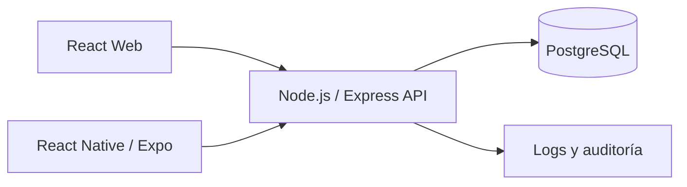

# Treo Wallet — Diseño técnico

**Estado:** En desarrollo  
**Versión:** 0.4  
**Fecha de actualización:** 11 de noviembre de 2026

## 1. Objetivo del diseño

Definir una arquitectura que permita construir una billetera digital de alcance acotado, priorizando integridad financiera, seguridad, trazabilidad y facilidad de evaluación.

Este documento mantiene la arquitectura objetivo del proyecto y registra el avance actual de implementación para distinguir las funcionalidades desarrolladas de las que siguen pendientes.

## 2. Arquitectura propuesta

Se propone un **monolito modular** con una API central. No se justifican microservicios para el alcance de esta prueba.

La arquitectura objetivo contempla una aplicación web y una aplicación móvil que consumen la misma API, con PostgreSQL como base de datos central.



### 2.1 Estructura del repositorio

El proyecto utiliza una estructura de monorepositorio:

```text
treowallet/
├── api/
├── docs/
├── mobile/
├── packages/
├── specs/
└── web/
```

La estructura permite mantener separados los clientes, la API, los componentes compartidos, las especificaciones y la documentación.

### 2.2 Estado actual de implementación

| Componente | Estado | Descripción |
|---|---|---|
| Repositorio | Completado | Estructura inicial creada y publicada en GitHub. |
| Entorno local | Completado | Node.js y PostgreSQL instalados. |
| Backend | En desarrollo | API Express con conexión PostgreSQL. |
| Autenticación | Implementada | Login con bcrypt y JWT. |
| Dashboard API | Implementado | Consulta de resumen financiero y últimos movimientos. |
| Frontend web | En desarrollo | React, TypeScript y Vite. |
| Login web | Implementado | Conectado con el endpoint de autenticación. |
| Dashboard web | Implementado | Consume información real de la API. |
| Base de datos | Implementado | Creada y conectada al backend |
| Aplicación móvil | Pendiente | Falta inicializar e implementar las pantallas |
| Integración completa | Pendiente | Los clientes todavía no consumen una API funcional |

## 3. Backend

### 3.1 Tecnologías propuestas

- Node.js 20 o superior.
- Express.
- TypeScript en modo estricto.
- TypeORM.
- PostgreSQL 15 o superior.
- Zod para validación.
- JWT y refresh tokens rotatorios.
- Argon2 o bcrypt para contraseñas.

Estas tecnologías forman parte de la arquitectura objetivo. Su implementación e integración se realizará durante el desarrollo del backend.

### 3.2 Organización lógica sugerida

```text
api/
└── src/
    ├── config/
    ├── modules/
    │   ├── auth/
    │   ├── users/
    │   ├── accounts/
    │   ├── beneficiaries/
    │   ├── transfers/
    │   ├── ledger/
    │   └── audit/
    ├── common/
    │   ├── errors/
    │   ├── middleware/
    │   └── logging/
    ├── database/
    │   ├── migrations/
    │   └── seeds/
    └── app.ts
```

Cada módulo deberá separar, según su complejidad, controladores, servicios, entidades/repositorios, esquemas de validación y pruebas.

La lógica financiera deberá permanecer en la capa de servicios y dominio, no directamente en los controladores de Express.

## 4. Modelo de datos inicial

Entidades propuestas:

| Entidad | Responsabilidad |
|---|---|
| `users` | Identidad, credenciales y estado del usuario |
| `accounts` | Cuentas y saldo disponible |
| `beneficiaries` | Beneficiarios registrados y CLABE |
| `transfers` | Operación de transferencia, estado, concepto y referencia |
| `ledger_entries` | Asientos de débito y crédito |
| `audit_logs` | Eventos relevantes de auditoría |
| `refresh_tokens` | Sesiones renovables y rotación de tokens |
| `idempotency_keys` | Resultado y huella de solicitudes idempotentes |
| `otp_challenges` | Retos OTP, expiración y consumo |

Las relaciones, índices, restricciones y columnas definitivas se detallarán antes de crear las migraciones.

El modelo deberá garantizar integridad referencial y consistencia de las operaciones financieras desde la base de datos.

## 5. Modelo monetario y ledger

- No utilizar `number` de JavaScript para operaciones monetarias.
- Representar importes como centavos enteros o como `NUMERIC` en PostgreSQL, definiendo una conversión segura en la API.
- Cada transferencia interna deberá producir al menos dos asientos: débito en la cuenta origen y crédito en la cuenta destino.
- La suma de los asientos de una transferencia deberá ser cero.
- El saldo de la cuenta podrá mantenerse como valor actualizado para consulta eficiente, pero deberá actualizarse en la misma transacción que los asientos.
- Incluir una estrategia de conciliación para detectar diferencias entre saldos y ledger.
- Aplicar restricciones de base de datos para impedir saldos negativos.
- Evitar que los cálculos monetarios dependan de operaciones de punto flotante.

## 6. Flujo transaccional de transferencia

Flujo propuesto:

1. Autenticar al usuario y validar que puede operar sobre la cuenta origen.
2. Validar el payload mediante Zod.
3. Verificar la clave de idempotencia y la huella de la solicitud.
4. Iniciar una transacción PostgreSQL.
5. Bloquear las cuentas afectadas mediante `SELECT ... FOR UPDATE` en orden determinista de identificador.
6. Verificar saldo, límites diarios, beneficiario/destino y requisitos OTP.
7. Crear la transferencia y sus asientos contables.
8. Actualizar los saldos dentro de la misma transacción.
9. Registrar el evento de auditoría.
10. Guardar el resultado asociado a la clave de idempotencia y confirmar la transacción.
11. Devolver el comprobante/resultado.

Ante cualquier error, revertir la transacción. Una repetición con la misma clave y el mismo contenido deberá devolver el resultado original sin volver a debitar. La misma clave con contenido diferente deberá rechazarse.

La alternativa `SERIALIZABLE` puede evaluarse, pero requiere reintentos acotados ante errores de serialización. La decisión final deberá documentarse y probarse.

## 7. Límites diarios y OTP

- El límite diario será configurable.
- La ventana diaria deberá calcularse usando la zona horaria de negocio acordada, inicialmente `America/Mexico_City`.
- La comprobación del límite deberá ser segura ante transferencias concurrentes.
- El OTP será simulado para la prueba técnica.
- El OTP deberá tener expiración, límite de intentos y consumo único.
- El umbral que activa OTP y el límite diario quedan pendientes de definir.

## 8. API y errores

- API REST versionada, por ejemplo `/api/v1`.
- Validación de entrada con Zod.
- Documentación OpenAPI 3.1.
- Errores con formato RFC 7807 (Problem Details).
- Middleware de autenticación, autorización, rate limiting y manejo centralizado de errores.
- Respuestas consistentes y códigos HTTP adecuados.
- No exponer detalles internos, credenciales ni información sensible en las respuestas.

Rutas iniciales candidatas:

- `/auth/register`
- `/auth/login`
- `/auth/refresh`
- `/auth/logout`
- `/accounts`
- `/beneficiaries`
- `/transfers`
- `/transactions`

Los contratos exactos se documentarán en OpenAPI.

## 9. Web y móvil

### 9.1 Aplicación web

La aplicación web consume la API mediante `fetch`, utilizando un servicio centralizado en `web/src/services/api.ts`.

Los endpoints integrados son:

| Método | Endpoint | Descripción |
|---|---|---|
| POST | `/api/auth/login` | Autenticación del usuario. |
| GET | `/api/dashboard` | Consulta del resumen financiero y movimientos. |

Las peticiones protegidas utilizan el encabezado:

`Authorization: Bearer <token>`

El frontend administra la sesión mediante almacenamiento local o de sesión del navegador, según la selección del usuario.

La API es responsable de validar el JWT y restringir la información consultada al usuario autenticado.

La integración fue comprobada mediante pruebas manuales de inicio de sesión, consulta de información financiera y cierre de sesión.

Tecnologías y herramientas previstas:

- React.
- TypeScript.
- Vite.
- CSS separado por componentes o páginas.
- TanStack Query para estado remoto cuando exista integración con la API.
- Formularios con validación.
- Formato monetario `es-MX`.
- Clave de idempotencia generada una vez por intento de transferencia y reutilizada ante reintentos del mismo intento.

#### Estructura actual de la aplicación web

```text
web/
└── src/
    ├── pages/
    │   ├── Login.tsx
    │   └── Dashboard.tsx
    ├── styles/
    │   └── Dashboard.css
    ├── App.tsx
    ├── App.css
    ├── index.css
    └── main.tsx
```

#### Login

Se implementó una interfaz visual de inicio de sesión que contempla:

- Campo de correo electrónico.
- Campo de contraseña.
- Opción para mostrar u ocultar la contraseña.
- Opción visual para recordar la sesión.
- Acciones visuales para recuperar contraseña y registro.
- Transición hacia el Dashboard después de iniciar sesión.

**Estado:** Interfaz implementada. La autenticación todavía no está conectada al backend y no existe una sesión real persistente.

#### Dashboard

Se implementó la interfaz principal de TreoWallet con:

- Menú lateral de navegación.
- Identidad visual de TreoWallet.
- Información de usuario de demostración.
- Resumen de saldo.
- Indicadores de ingresos y gastos.
- Lista de movimientos recientes.
- Acciones rápidas.
- Opción para cerrar sesión y regresar al Login.

**Estado:** Interfaz implementada visualmente. Los importes, usuarios y movimientos mostrados son datos de demostración; todavía no se obtienen de PostgreSQL ni de una API.

#### Separación de responsabilidades

- `App.tsx`: controla la navegación actual entre Login y Dashboard mediante estado local de React.
- `Login.tsx`: contiene la interfaz de inicio de sesión.
- `Dashboard.tsx`: contiene la interfaz del panel principal.
- `Dashboard.css`: contiene los estilos del Dashboard.
- `App.css` e `index.css`: contienen estilos generales y de la aplicación.

La navegación actual es local y temporal. La autenticación real y el control de rutas protegidas se implementarán cuando exista el backend.

#### Pendientes de la aplicación web

- Conectar Login con el endpoint de autenticación.
- Implementar persistencia y renovación segura de sesión.
- Obtener saldo y movimientos desde la API.
- Implementar historial con filtros y paginación.
- Implementar alta y administración de beneficiarios.
- Implementar el flujo de transferencias y comprobantes.
- Incorporar validación de formularios.
- Incorporar estados de carga, vacío y error.
- Integrar TanStack Query para los datos remotos.
- Implementar pruebas de componentes y flujos principales.

### 9.2 Aplicación móvil

Tecnologías propuestas:

- React Native con Expo.
- TypeScript.
- Tokens en almacenamiento seguro del sistema.
- Reutilizar la misma clave de idempotencia cuando se reintente una solicitud por pérdida de conectividad.
- Mostrar el estado confirmado por el servidor, sin asumir que una solicitud fallida de red significa que la transferencia no ocurrió.
- Ocultar información sensible al pasar a segundo plano.

La aplicación móvil todavía está pendiente de inicialización e implementación.

## 10. Pruebas y calidad

Se deberán implementar las siguientes pruebas:

- Unitarias para reglas de dominio y validadores.
- Validación de CLABE y su dígito verificador.
- Integración con PostgreSQL real.
- Pruebas de idempotencia, límites y saldo no negativo.
- Prueba de 100 transferencias simultáneas desde una cuenta.
- Seed de al menos 100,000 movimientos y revisión con `EXPLAIN ANALYZE`.
- Pruebas de componentes y flujo web.
- Prueba del flujo de transferencia, incluyendo saldo insuficiente.
- Lint y pruebas en CI.

**Estado actual:** Las pruebas de backend, integración financiera y concurrencia están pendientes. La implementación visual del Login y Dashboard no debe considerarse una prueba de integración funcional.

## 11. AWS — propuesta inicial

No se realizará despliegue como parte del alcance. La propuesta a documentar considera:

- ECS Fargate para ejecutar la API.
- Amazon RDS PostgreSQL Multi-AZ, respaldos y recuperación a un punto en el tiempo.
- S3 y CloudFront para los recursos web.
- Secrets Manager para secretos.
- CloudWatch, CloudTrail y OpenTelemetry/X-Ray para observabilidad.
- GitHub Actions con OIDC para CI/CD.
- RDS Proxy o pooling de conexiones para controlar conexiones a PostgreSQL.
- Infraestructura como código mediante AWS CDK o Terraform.

Se deberán documentar RPO/RTO, retención de auditoría, estrategia de ambientes y escalamiento.

## 12. Decisiones por cerrar

- Umbral OTP y límite diario.
- Tipos y estados definitivos de transferencia.
- Política de expiración y revocación de refresh tokens.
- Estrategia final para concurrencia y reintentos.
- Índices y estrategia de consulta de historial.
- Configuración de ambientes local, pruebas y CI.
- Política de almacenamiento y renovación de tokens en web.
- Estrategia de navegación y protección de rutas.
- Contratos definitivos entre frontend y backend.

## 13. Historial de versiones

| Versión | Fecha | Cambios |
|---|---|---|
| 0.1 | 10/11/2026 | Diseño inicial de arquitectura, backend, modelo de datos y estrategia financiera. |
| 0.2 | 11/11/2026 | Actualización del estado del proyecto. Se documenta la estructura web, Login y Dashboard implementados visualmente, así como las tareas de integración pendientes. |
| 0.3 | 11/11/2026 | Creación de la base de datos en PostgreSQL, integración y conexión con el backend de Treo Wallet, e implementación del hash de contraseñas para su almacenamiento seguro. |
| 0.4 | 11/11/2026 | Integración y conexión entre el backend, la base de datos PostgreSQL y el frontend de Treo Wallet. |
