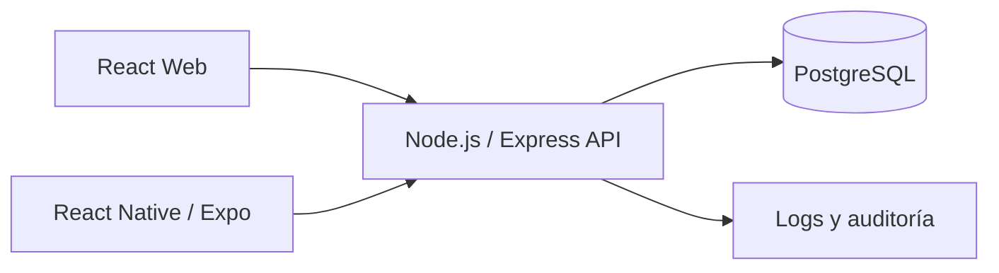

# Treo Wallet — Diseño técnico

**Estado:** Borrador inicial  
**Versión:** 0.1  
**Fecha:** 10 de noviembre de 2026

## 1. Objetivo del diseño

Definir una arquitectura inicial que permita construir una billetera digital de alcance acotado, priorizando integridad financiera, seguridad, trazabilidad y facilidad de evaluación.

## 2. Arquitectura propuesta

Se propone un **monolito modular** con una API central. No se justifican microservicios para el alcance de esta prueba.



Monorepo propuesto:

```text
treowallet/
├── api/
├── web/
├── mobile/
├── packages/
│   └── shared/
├── specs/
└── docs/
```

## 3. Backend

Tecnologías:
- Node.js 20+.
- Express.
- TypeScript estricto.
- TypeORM.
- PostgreSQL 15+.
- Zod.
- JWT y refresh tokens rotatorios.
- Argon2 o bcrypt para contraseñas.

Organización lógica sugerida:

```text
api/src/
├── config/
├── modules/
│   ├── auth/
│   ├── users/
│   ├── accounts/
│   ├── beneficiaries/
│   ├── transfers/
│   ├── ledger/
│   └── audit/
├── common/
│   ├── errors/
│   ├── middleware/
│   └── logging/
├── database/
│   ├── migrations/
│   └── seeds/
└── app.ts
```

Cada módulo deberá separar, según su complejidad, controladores, servicios, entidades/repositorios, esquemas de validación y pruebas.

## 4. Modelo de datos inicial

Entidades propuestas:

| Entidad | Responsabilidad |
|---|---|
| `users` | Identidad, credenciales y estado del usuario |
| `accounts` | Cuentas y saldo disponible |
| `beneficiaries` | Beneficiarios registrados y CLABE |
| `transfers` | Operación de transferencia, estado, concepto y referencia |
| `ledger_entries` | Asientos de débito y crédito |
| `audit_logs` | Eventos relevantes de auditoría |
| `refresh_tokens` | Sesiones renovables y rotación de tokens |
| `idempotency_keys` | Resultado y huella de solicitudes idempotentes |
| `otp_challenges` | Retos OTP, expiración y consumo |

Las relaciones, índices, restricciones y columnas definitivas se detallarán antes de crear las migraciones.

## 5. Modelo monetario y ledger

- No utilizar `number` de JavaScript para operaciones monetarias.
- Representar importes como centavos enteros o como `NUMERIC` en PostgreSQL, definiendo una conversión segura en la API.
- Cada transferencia interna deberá producir al menos dos asientos: débito en la cuenta origen y crédito en la cuenta destino.
- La suma de los asientos de una transferencia deberá ser cero.
- El saldo de la cuenta podrá mantenerse como valor actualizado para consulta eficiente, pero deberá actualizarse en la misma transacción que los asientos.
- Incluir una estrategia de conciliación para detectar diferencias entre saldos y ledger.
- Aplicar restricciones de base de datos para impedir saldos negativos.

## 6. Flujo transaccional de transferencia

Flujo propuesto:

1. Autenticar al usuario y validar que puede operar sobre la cuenta origen.
2. Validar el payload mediante Zod.
3. Verificar la clave de idempotencia y la huella de la solicitud.
4. Iniciar una transacción PostgreSQL.
5. Bloquear las cuentas afectadas mediante `SELECT ... FOR UPDATE` en orden determinista de identificador.
6. Verificar saldo, límites diarios, beneficiario/destino y requisitos OTP.
7. Crear la transferencia y sus asientos contables.
8. Actualizar los saldos dentro de la misma transacción.
9. Registrar el evento de auditoría.
10. Guardar el resultado asociado a la clave de idempotencia y confirmar la transacción.
11. Devolver el comprobante/resultado.

Ante cualquier error, revertir la transacción. Una repetición con la misma clave y el mismo contenido deberá devolver el resultado original sin volver a debitar. La misma clave con contenido diferente deberá rechazarse.

La alternativa SERIALIZABLE puede evaluarse, pero requiere reintentos acotados ante errores de serialización. La decisión final deberá documentarse y probarse.

## 7. Límites diarios y OTP

- El límite diario será configurable.
- La ventana diaria deberá calcularse usando la zona horaria de negocio acordada, inicialmente `America/Mexico_City`.
- La comprobación del límite deberá ser segura ante transferencias concurrentes.
- El OTP será simulado para la prueba técnica.
- El OTP deberá tener expiración, límite de intentos y consumo único.
- El umbral que activa OTP y el límite diario quedan pendientes de definir.

## 8. API y errores

- API REST versionada, por ejemplo `/api/v1`.
- Validación de entrada con Zod.
- Documentación OpenAPI.
- Errores con formato RFC 7807 (Problem Details).
- Middleware de autenticación, autorización, rate limiting y manejo centralizado de errores.
- Respuestas consistentes y códigos HTTP adecuados.

Rutas iniciales candidatas:
- `/auth/register`, `/auth/login`, `/auth/refresh`, `/auth/logout`
- `/accounts`
- `/beneficiaries`
- `/transfers`
- `/transactions`

Los contratos exactos se documentarán en OpenAPI.

## 9. Web y móvil

### Web
- React.
- TanStack Query para estado remoto.
- Formularios con validación.
- Formato monetario `es-MX`.
- Clave de idempotencia generada una vez por intento de transferencia y reutilizada ante reintentos del mismo intento.

### Móvil
- React Native con Expo.
- Tokens en almacenamiento seguro del sistema.
- Reutilizar la misma clave de idempotencia cuando se reintente una solicitud por pérdida de conectividad.
- Mostrar el estado confirmado por el servidor, sin asumir que una solicitud fallida de red significa que la transferencia no ocurrió.
- Ocultar información sensible al pasar a segundo plano.

## 10. Pruebas y calidad

- Unitarias para reglas de dominio y validadores.
- Integración con PostgreSQL real.
- Pruebas de idempotencia, límites, saldo y concurrencia.
- Prueba de 100 transferencias simultáneas desde una cuenta.
- Seed de al menos 100,000 movimientos y revisión con `EXPLAIN ANALYZE`.
- Pruebas de componentes y flujo web.
- Lint y pruebas en CI.

## 11. AWS — propuesta inicial

No se realizará despliegue como parte del alcance. La propuesta a documentar considera:
- ECS Fargate para ejecutar la API.
- Amazon RDS PostgreSQL Multi-AZ, respaldos y recuperación a un punto en el tiempo.
- S3 y CloudFront para los recursos web.
- Secrets Manager para secretos.
- CloudWatch, CloudTrail y OpenTelemetry/X-Ray para observabilidad.
- GitHub Actions con OIDC para CI/CD.
- RDS Proxy o pooling de conexiones para controlar conexiones a PostgreSQL.
- Infraestructura como código mediante AWS CDK o Terraform.

Se deberán documentar RPO/RTO, retención de auditoría, estrategia de ambientes y escalamiento.

## 12. Decisiones por cerrar

- Umbral OTP y límite diario.
- Tipos y estados definitivos de transferencia.
- Política de expiración y revocación de refresh tokens.
- Estrategia final para concurrencia y reintentos.
- Índices y estrategia de consulta de historial.
- Configuración de ambientes local, pruebas y CI.
